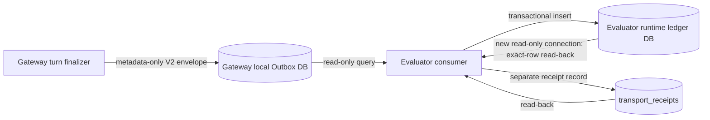
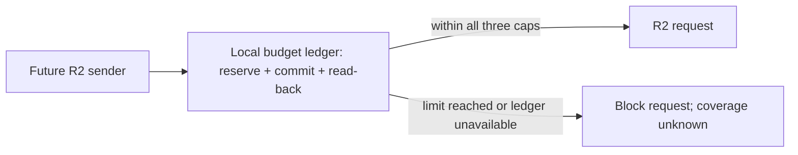

# WP2 Durable Outbox / Consumer ACK — 設計案

- 状態: WP2 transport primitiveとWP3 value-free reportの隔離実装案。canonical root/owner/retention/HMAC policyとhost-volume failure scopeはユーザー承認済み。root directoryはmode `0700`で作成・検証済み。Outbox/ledgerの手動purge primitiveはfixture DBで検証済み。HMAC用Keychain custody、remote journal/ACK統合、Gateway接続と実runtimeは未実施。2026-10-21にR2 S3 adapterでcredential retrievalと合成object 1件のPUT/GETを検証したが、これは独立remote journalの接続ではない（Section 7）。purgeはcanonical rootに実行していない。
- 対象: Hermes側の永続Outbox primitive、Evaluator側のread-only Outbox consumer、別レコードACK receipt、明示DB指定のtransport report。
- 対象外: Gatewayへのhook接続、設定変更、実Gateway起動、実会話、Gateway/Agent経由のProvider統合、LaunchAgent、既存report/promotion pipelineへの統合。R2 adapterの単発smokeはSection 7に限定記録する。

## 1. 設計判断

1. OutboxとEvaluator ledgerは別のSQLite DBとする。SQLiteはPython標準ライブラリで利用でき、トランザクションと一意制約で重複・競合を扱える。ファイルパスは呼出側から必須指定し、既定値・環境変数fallbackを置かない。
2. Hermes Outboxは検証済みV2 envelopeだけを受け付ける。Validatorは必須依存として注入し、未指定・例外・validation error時は保存しない。Gateway側にEvaluator採点処理やsubprocessを持ち込まない。
3. 運用DBはdata path上で自動生成・migrationしない。Outbox/ledgerのinitializerを明示呼出しした場合だけ、指定先にversion 1 DBを作る。通常writer/consumerは既存DBとschemaを検証し、missing/unknown/malformed DBを拒否する。
4. Outboxの一意性は`event_ref`。同じ`event_ref + payload_hash + schema_version`の再投入はduplicate。同じ`event_ref`で既存tupleと異なる候補はconflictテーブルへ別保存し、先行イベントを変更しない。
5. Evaluator consumerはOutbox DBをSQLite URIのread-only modeで開く。Envelopeは既存のV2 structural validatorを通し、canonical payload bytesと`payload_hash`を照合する。provenance、HMAC参照、persistence receiptは構造検査に留まり、真正性を認証したとは扱わない。
6. Evaluator ledgerはevent単位で一意保存し、トランザクションcommit後に別のread-only connectionで該当行を再取得する。bytes、schema version、payload hashが一致した場合だけ、`transport_receipts`へACKを保存する。ACKもcommit後に別connectionでread-backする。
7. ACK receiptはEnvelopeの外に置く。`sink_id`、`event_ref`、`payload_hash`、`schema_version`、ledger row hash、read-back結果、時刻を記録し、同じeventの再処理は既存receiptを返す。
8. Retentionは60日、削除責任者はユーザー本人とする方針が承認済み。OutboxとEvaluator ledgerの手動purge primitiveはfixture DBで検証済み。Gatewayやschedulerから自動呼出しせず、canonical root上のDBには実行していない。remote journal retentionはprovider選定後の設計が残る。
9. Outboxが利用不能なturnの独立分母はこの実装では記録しない。呼出し元へ値を含まない`outbox_unavailable`を返すだけに留める。このためWP2全体のcapture-completeness受入は未達のままとする.

Mac隔離APFS sparse imageでfilesystem `ENOSPC` fixtureを実施し、Outbox/Consumerのfail-closed挙動を確認した。これは実host-volume試験ではない。対象failure scopeとしてhost-volume容量枯渇まで、ownerをユーザー本人とする方針、Outboxと独立したremote metadata-only journalの設計形状は承認済みだが、provider/destinationは未選定。`emitted`は独立journalが実装・read-back検証されるまで`null`とする。

2026-10-21のユーザー承認: canonical root `/Users/yokapro/.hermes/runtime-evidence/agent-level/v2`、directory mode `0700`・DB mode `0600`、retention 60日、削除責任者はユーザー本人、macOS Keychainのprofile別HMAC key、年次または漏えい疑い/owner変更時rotation、旧keyは期限内record検証専用、domain separation=`agent-level/runtime-evidence/v2`。parent directory chainと作成済みrootはowner/mode/ACLを検証済み。Outbox/ledger purge APIはfixture検証済みだが運用DB未実行。Keychain、canonical DB pathの実使用、remote retentionは未実施。

## 2. データフロー

この設計案の実装ではAへのhook接続をしない。Gateway応答経路とconsumer/reportは独立したままにし、WP6の隔離E2Eまでend-to-end接続済みとは扱わない。

## 2.1 Storage contract

Gateway Outbox DBのversion 1は次の論理表を持つ。

- `outbox_events(seq, event_ref UNIQUE, payload_hash, schema_version, envelope_json, created_at)`
- `outbox_conflicts(conflict_id, event_ref, payload_hash, schema_version, candidate_sha256, envelope_json, recorded_at)`。`(event_ref, candidate_sha256)`を一意にする。
- `PRAGMA user_version=1`。未知versionは変更・migrationせず拒否する。

Evaluator ledger DBのversion 1は次の論理表を持つ。

- `runtime_events(event_ref PRIMARY KEY, payload_hash, schema_version, envelope_json, record_hash, committed_at)`
- `runtime_event_conflicts(conflict_id, event_ref, payload_hash, schema_version, candidate_sha256, envelope_json, recorded_at)`。既存eventを更新せず、候補を別行に保全する。
- `transport_receipts(event_ref, payload_hash, schema_version, sink_id, receipt_json)`。複合keyで同一receiptの再作成を防ぐ。
- `PRAGMA user_version=1`。未知versionは拒否する。

各DBは`journal_mode=DELETE`、`synchronous=FULL`、`BEGIN IMMEDIATE`で書く。Writer transactionをcommitした後、新しいread-only connectionで保存行を照合する。Outbox conflict候補・ledger conflict候補も、V2 validationを通過したcanonical bytesだけを保持する。

ACK receipt V1のallowlistは次のとおり。

- `receipt_type=runtime_evidence_transport_ack`
- `receipt_schema_version=1`
- `sink_id`（明示設定された1〜64文字のlowercase identifier）
- `event_ref`、`payload_hash`、`event_schema_version=2`
- `disposition=persisted|duplicate`
- `ledger_record_hash=sha256:<64 lowercase hex>`
- `readback_status=exact_match`
- `acknowledged_at`（V2と同じcanonical UTC timestamp subset）

Conflict、invalid event、DB failureにACK receiptは発行しない。Receiptの署名・暗号学的認証はこのWP2案の範囲外であり、read-backは保存状態の確認を意味する。

## 3. 状態遷移

| 現在状態 | 操作 | 次状態 | 条件 |
|---|---|---|---|
| absent | enqueue | outbox_persisted | V2検証成功、DB transaction commit後に同じeventをread-back |
| outbox_persisted | enqueue same tuple | duplicate | 保存済みcanonical bytesが一致 |
| outbox_persisted | enqueue same ref, different hash/version | conflict_preserved | 別行へ保存、既存行は不変 |
| outbox_persisted | consume | ledger_persisted | V2再検証後、ledger transaction commit |
| ledger_persisted | exact read-back | ledger_verified | 新規read-only connectionで完全一致 |
| ledger_verified | persist receipt | ack_persisted | 既存receiptと矛盾しない |
| ack_persisted | exact read-back | acknowledged | 新規read-only connectionでreceipt完全一致 |
| any | storage/validation failure | unavailable / rejected | raw exceptionやpayloadをログへ出さない。ACKを返さない |
| ledger has same ref, different tuple | consume | conflict_preserved | ledgerを上書きせず、競合候補を別保存。ACKを返さない |

必須不変条件:

- `acknowledged => ledger_verified`。ACK保存より前にledger exact-row read-backが成立している。
- 同じevent_refのpayload/schema conflictで既存ledger rowを更新しない。
- Envelopeのtransport/measurement/eligibility状態を書き換えない。
- Structural validationはprovenance、鍵、canonical persistenceの真正性証明にならない。
- Consumer障害・Outbox障害をAgent応答の成功/失敗へ伝播させない。実Gatewayへの結線はこのWP2実装には含めない。

## 4. 依存の扱い

必須パラメータは`outbox_db_path`、`ledger_db_path`、`sink_id`、Gateway writer側のvalidatorである。fixture testでは引き続き`TemporaryDirectory`配下のDBとsynthetic V2 eventだけを使い、実配置先を開かない。

以下の意思決定は実装で代替しない。

- runtime DBの作成と実使用時のowner/mode/ACL検証
- canonical root上のDB path実使用、手動purge運用導線、remote journal retentionの実装・検証
- HMAC Keychain保管・rotation機構の実装・custody検証
- Outbox unavailableを独立計測するremote journalのprovider/destination・ACK/read-back契約
- read-only episode resolver scope

2026-10-21、ユーザーは推奨defaultsとpilot範囲の採用を指示した。canonical rootは`/Users/yokapro/.hermes/runtime-evidence/agent-level/v2`、directory `0700`、DB `0600`、retention 60日、削除責任者はユーザー本人。HMAC keyはactive profileごとにmacOS Keychainで保管し、年次または漏えい疑い/owner変更時にrotation、domain separationは`agent-level/runtime-evidence/v2`とする。capture denominatorはhost-volume容量枯渇まで対象とし、Outboxと独立したfailure domainのremote metadata-only journalを採用する。bounded pilotは現`#agent-level`・default profile・手動・最大1 event・schedulerなしとする。これらは設計/pilot scopeの承認であり、canonical DB pathのruntime使用とpurge運用導線、Keychain実装、remote provider/destination、Gatewayへの設定・接続、独立reviewer/providerの指定を代替しない。

Mac上で観測した`/Volumes` mountはsystem volumeとAPFS physical storeを共有しており、独立journal先として使えない。独立journalのprovider/destination・ACK/read-back契約は未決。remote backendとそのMac ENOSPC試験が成立するまでcapture completenessは未達とする。

### 4.1 Outbox unavailable時の分母 — 設計候補

現行reportの`emitted=null`は維持する。ここで数える対象は、少なくとも「turn finalizerでsettleしたturn」と「Observerがcaptureを試みたevent」に分けて定義する必要がある。Outboxへのenqueue成功数だけでは、Outboxを使えなかった試行を数えられない。

| 候補 | 数えられる範囲 | 共通障害・制約 | 状態 |
|---|---|---|---|
| Outboxとは別のSQLite journal（同一volume） | Outbox DBのschema/lock障害時に、enqueue試行と失敗statusを先行記録できる | volume容量枯渇・権限障害・process停止は共有。物理disk failureまで独立とは言えない | 候補。採択なし |
| Hermes `state.db`のcanonical record | canonical persistenceが成功したturnの一部を再集計できる可能性 | `state.db` unavailableやpersistence failure時のturnを数えられず、content-bearing canonical DBを集計用に読む境界も未承認 | 候補。read-only scope未承認 |
| 独立した監視・遠隔journal | host-volume容量枯渇時もOutboxとは別failure domainにcapture attemptを残す | durable ACK/read-back、privacy、識別子、鍵、network、60日retentionと削除統制が必要 | 設計方針は承認済み。provider/destinationと契約は未選定 |

完全なcapture分母を主張するには、承認済みのhost-volume failure scopeに対して、settled-turnごとの一意性、journalへの書込順序、再試行時の重複排除、journal自体の利用不能時にcoverageを`unknown`へ落とす規則が必要。別SQLite fileや同じAPFS physical store上のvolumeではhost-volume容量枯渇を独立して記録できないため、provider/destinationとACK契約が決まるまで実装を固定しない。

次のfixture受入条件は、選択されたjournalについて、Outbox成功/失敗、journal commit前後のprocess終了、重複settle、retry、journal read-back不能を注入し、capture attempt・persisted数のreconciliationと`unknown`状態を検証すること。journalが読めない場合、reportは`emitted=0`を出さず`null`と理由を返す。

## 4.2 R2 free-tier budget guard — implementation contract

Cloudflareの公開料金ページが示すStandard無料枠は月10 GB-month、Class A 1,000,000 requests、Class B 10,000,000 requestsで、egressは無料。無料枠超過を止めるaccount-level hard capは確認できていない。Cloudflareのbudget alertは通知専用で利用を停止しない。[1][2]

本プロジェクト側では、remote senderの全R2操作より前に、明示指定されたローカルbudget ledgerへ予約をcommitし、新しいread-only connectionでread-backできた場合だけR2 requestを許可する。許可値は一度のR2 requestにつきClass AまたはBの1操作を予約し、失敗・timeout・応答不明でも返金しない。Object writeはopaque object referenceのSHA-256とbyte数を記録し、同じobjectの再試行では操作回数を再予約するが、storage bytesは二重計上しない。削除・縮小・未確認のwrite失敗でstorage予約を返金しない。

無料枠の80%をこのruntime-evidence用途の**lifetime cap**として割り当てる。上限は累積8,000,000,000 bytes、Class A 800,000 requests、Class B 8,000,000 requests。カウンターは自動リセットしない。各上限到達後、明示的な人手確認と請求期間・アカウント使用量の照合が終わるまで再許可しない。Lifetime capは月次枠より保守的であり、billing cycle境界の推定誤りを避ける。

このガードは当該senderが通るR2 requestだけを制御する。Cloudflare account内の別bucket・別サービス利用は数えず、account全体の$0を保証しない。実際のR2接続前に専用の空bucketを確認し、同じaccountの既存使用量をDashboardで照合する必要がある。Budget ledgerはMacのローカルvolume上に置くため、ledger自身が利用不能ならfail closedする。その場合、host-volume full時にもremote captureできるという目標は満たせず、capture coverageはunknownとなる。これは無料枠超過防止を優先する設計上のトレードオフである。

OutboxはHermes `gateway/runtime_evidence_outbox.py`とcandidate testで実装済み。Outbox自体はGateway runtimeに接続されておらず、MacのローカルSQLiteは同じhost volumeの容量枯渇を独立して記録できない。

`BudgetedR2ObjectJournal`境界とin-memory fake transport testを実装済み。加えてHermes candidateへ`gateway/runtime_evidence_r2_s3.py`を追加し、macOS Keychain Generic Password lookupとboto3 1.42.89 S3 adapterを用意した。初期実装ではlabel `R2アクセス`を候補としていたが、実際に確認したitem labelは`R2Key`である。fixtureのsynthetic runner/clientで、S3 `IfNoneMatch="*"`、HTTP 412 duplicate、単一attempt、bounded read、budget reservation順序を検証した。Botocore 1.42.89のservice modelはPutObjectの`IfNoneMatch`を受理する。focused macOS suiteは**68 passed、1 skipped**。この段落の初回記録時点では実credential loaderと実S3 requestをまだ実行していなかった。2026-10-21の後続Keychain readおよび1回のadapter-level Provider smokeはSection 7に記録した。Gateway/Outbox consumer接続はない。budget ledgerはMacローカルで、lifetime capはCloudflare月次請求メーターと一致せず、account-wide $0を保証しない。

## 5. WP2 acceptance status

WP2のisolated transport primitiveは実装済み。2026-10-21続行後のEvaluator全fixture suiteは標準Pythonで**172 tests, failures=0, errors=0, skipped=1**（skipは標準Pythonに`jsonschema`がないため）、Hermes venvでは**172 PASS、skip 0**。Report focused suiteは**16/16 PASS**で、SQLite TEXTの文字数とUTF-8 byte数が異なる oversized `event_ref`/hashをOutbox・ledger・対象receipt各境界へ入れ、byte上限超過がpayload decodeまたはreceipt validation前に拒否されることを確認した。Hermes focused transport suite on macOS **68 passed, 1 skipped**（Outbox 28、budget 14、fake transport 10、S3 adapter 16。skipはLinux専用ACL test）。Hermes Outbox、Evaluator consumerそれぞれで、独立process 2つをSQLite writer lock下に競合させ、解放後に1行へ収束することを確認した。commit直後のread-back前、receipt commit後のprocess終了を注入し、再実行で復旧することも確認した。Outbox/ledger/receiptのinsert直後の例外を注入し、rollback、整合性維持、再試行後のread-back/ACKを確認した。さらに各write connectionにSQLite `max_page_count`を適用し、`SQLITE_FULL`時にOutboxが行を残さず、ConsumerがACKを保留すること、上限解除後の再試行が一度だけ成功することを確認した。これはSQLite論理容量のfixtureであり、ホスト物理volumeの枯渇試験ではない。両DB initializerは制限umask下でmode `0600`に作成する。same-version malformed DB、canonical schema外trigger/table/index/DDLをwrite前に拒否し、既存DB bytes不変をfixtureで確認。Consumerはcanonical table DDLを照合し、追加CHECK制約とcustom indexも拒否する。version 0 DBにuser viewがある場合もOutbox/ledger initializerはschema作成前に拒否し、bytes不変を確認した。`#?%`を含むパスでもread-only URIの読み取りが成功し、書込みが拒否されることを確認した。DB pathの親directory chainも全段検査し、ユーザー所有symlink、unsafe owner/mode、`..`を拒否する。OutboxとEvaluator ledgerのDB inodeはwriter/read-only双方でeffective UID所有を要求する。macOSの正常所有DB controlとforeign-UID `lstat` metadata injectionを両DB・両経路で確認した（foreign ownerの実`chown` fixtureは未実施）。root所有OS symlinkは元path側と解決先双方を検査する。macOSは`acl_get_file(ACL_TYPE_EXTENDED)`で全parent directoryとDB inodeのACLをfail-closed検査し、LinuxはPOSIX ACL xattrを検査する。ACL付きpath拒否と、ACL照会後も別processの`BEGIN IMMEDIATE`が保持されることをfixtureで確認した。consumerの同一process競合40反復は失敗0.

`jsonschema`はEvaluator標準Python環境にはないが、既存Hermes venvの`jsonschema 4.26.0`で両SchemaのDraft 2020-12 schema-checkを実行した。有効Envelope/ACKを受理し、未知key・boolean整数定数・無効日付を拒否。依存追加とnetwork accessはしていない。これは標準validatorのfixture確認であり、第三者reviewではない。

WP2全体の受入は未達。Cloudflare R2は単発smoke先として使用したが、Outbox unavailable独立分母となるremote journalの統合とACK/read-back、HMAC Keychain実装・検証、canonical root上のDB使用と手動purge運用導線、remote retentionが残る。Outbox/ledger purge primitiveはfixture DBで60日cutoff、境界保持、bounded batch、ACK先行削除、read-backを検証したが、運用DBへは実行していない。ホスト物理volume/remote destinationの実配置先での容量枯渇も未検証。隔離APFS sparse imageでfilesystem `ENOSPC`時のOutbox/Consumer failure・retryをfixture確認済み。SQLite `max_page_count`による論理FULL fixtureも確認済み。Gateway finalizerにhookしていないため、実GatewayからEnvelopeを捕捉した状態でもない。

WP2/WP3追加candidateの独立reviewは未実施。最新macOS Gateway全体suiteは**779 files、7,808 passed、11 failed、43 skipped**。失敗11件は直前の7,803 passed runと同じtest IDだった。配信関連7失敗は、local HEAD `f09ccc3aa78294bbc391a1074ee4212f6aef9cb7`をclean archiveしたbaselineでも同じassertionで再現したという前回記録があるが、subset/baseline実行自体もexit 1で、今回clean baselineを再実行していない。残る4件はpath長/socket機能に関するmacOS上の`OSError`である。従ってGateway全体suiteはgreenではない。remote fetchはしておらず、remote最新状態は未確認。v5 reviewは前段WP0/WP1 exact-set限定で、今回の追加コード・reportへ適用しない。

## Sources

[1] https://developers.cloudflare.com/r2/pricing — Cloudflare R2 pricing
[2] https://developers.cloudflare.com/billing/manage/budget-alerts — Cloudflare budget alerts

## 6. WP3 report slice

`scripts/runtime_evidence_transport_report.py`は明示したOutbox DB・ledger DB・sink ID・record limitだけを読み、値を含まないcountsを返す。`emitted`、`measurement_complete`、`evaluation_eligible`は未観測状態を`null`と理由コードで表し、zeroへ置換しない。receiptはOutbox・ledger双方のpayloadと一致した場合だけACKとして数える。

各recordの上限だけでは、`MAX_REPORT_RECORDS=100,000`件の各行を`fetchall()`すると、Envelope 2表と対象sink receipt表のpayload bytesだけで最大1,843,200,000 bytes（約1,757.81 MiB）となり、decode後の複製・Python object overheadは別途発生する。修正後はpayload-bearing rowsをcursor iteratorで逐次読み、lookup mapにはcanonical EnvelopeのSHA-256 digestと固定metadataだけを保持する。加えて、canonical SQLite DDLだけではTEXT値の長さが制約されないため、Outboxの`event_ref`/`payload_hash`、ledgerの`event_ref`/`payload_hash`/`record_hash`、対象receiptの`event_ref`/`payload_hash`についてSQL byte lengthをfetch前に検査する。上限はSchemaに合わせて96/71/71 bytesとし、超過時は`report_record_size_exceeded`で終了する。EnvelopeとreceiptのBLOB上限もそれぞれ8,192/2,048 bytesをfetch前に検査する。`test_report_streams_payload_bearing_rows`はpayload queryで`fetchall()`を試みる実装を拒否し、oversized metadata regressionsは各DB境界で事前拒否を検証する。record件数上限は維持し、metadata mapの最大件数は引き続きその上限に従う。cross-store一致はbyte列を保持せず、canonical digest・payload hash・schema versionで照合する。

このreport単体では実際のturn count、能力測定、promotion判定を示さない。既存`evidence_report.py`への明示的な隔離接続条件は§6.1に記録する。

### 6.1 Existing Evidence Reportへの明示的なtransport subreport

実装済みのEvaluator-side隔離経路では、`evidence_report.py`にruntime transport subreportを任意で添付する。添付にはOutbox DB path、ledger DB path、`sink_id`、`max_records`の4値をすべて呼出側が明示する。1つでも欠ける場合は拒否し、default path・環境変数fallback・runtime rootの自動参照を設けない。未指定時は従来のEvidence reportのみを返す。

transport結果は`runtime_transport`名前空間に隔離し、既存の`records`・Evidence gate統計・Promotion判断へ混ぜない。`emitted`、`measurement_complete`、`evaluation_eligible`の未実装値は引き続き`null`と理由コードを返す。transport subreportはread-only DB接続を使い、report生成によるDB変更を認めない。Shadow/LegacyのPromotion exclusionは既存gateの既定動作を維持し、Shadow閲覧は明示environment selectorに限る。

report schema version 2はper-event IDを出さず、`outcome_counts`にcategory別countのみを返す。`accepted`はexact consumer ACK数、`rejected`はinvalid outbox/ledger rowとinvalid receiptのreason別件数、`conflict`はOutbox conflict rowとledger conflict rowを別々に数える。`duplicate`は重複発生を永続記録していないため`null`とreason codeを返し、0と誤認させない。reason bucketはrow/receipt単位であり、同一eventの重複排除済み総数ではない。個別のopaque reference listは出力しない。

この接続の受入範囲は、合成DBからの値の分離表示、explicit-args必須、既存Evidenceレコードの不変、DB read-only、未実装分母の`null`維持、category countとduplicate未観測の明示までとする。実Gateway/SessionDB/R2接続、source authenticity、capture completeness、semantic measurement、promotion eligibilityの証拠にはならない。

## 7. 2026-10-21 R2 adapter smoke update

2026-10-21のR2 adapter smokeはユーザーの許可意図に含まれる1回の限定操作だった。Hermes candidateのbudgeted journalとboto3 adapterから`agent-level-runtime-evidence-v2`へ合成metadataを1件PUTし、1件GETした。`write_once`は`persisted`、read-back bytesは送信payloadと一致した。ユーザーは後続で「じゃ、続けて」がこのPUT/GET 1回への許可意図だったと明確化した。object keyは`runtime-evidence/v2/49f6731bb5db520e9f9b3f525e887dd3226feaa9f1f9329a68ef9464e65df369`で、削除せず残置している。この限定許可は追加request、削除、Gateway統合、実会話送信、WP受入を含まない。

この1回の試験はKeychain読取りとR2 S3 adapter経由のProvider smokeを観測した。ユーザーはこの1回のPUT/GETを「じゃ、続けて」の許可範囲と明確化している。これは追加通信や受入承認の許可ではない。繰返し安定性、account全体の使用量・課金停止、Gateway runtime接続、OutboxからEvaluator ledger/reportまでの統合、通常会話のcapture completenessは確認していない。WP2全体の受入は未達のままである。

## Sources

[1] https://developers.cloudflare.com/r2/pricing — Cloudflare R2 pricing
[2] https://developers.cloudflare.com/billing/manage/budget-alerts — Cloudflare budget alerts
