# WP5 — Episode Assembler 設計

- 状態: **fixture-only contract／episode assembly実装済み・直近変更の再検証済み**。WP5のruntime source admission、実会話処理、rater-B接続は未完了。
- 対象: Evaluator repository内のread-only resolver契約、trajectory assembler、sanitized evidence、Human Calibration packet。
- 非対象: Gateway hook/設定/起動、実会話capture、canonical conversation storeへの接続、外部review送信、Promotion。
- 根拠: `docs/gateway-real-conversation-evaluation-work-plan.md` WP5、`docs/human-calibration-rubric.md`、`docs/measurement-first-capability-design.md`。

## 1. 現在地

既存の `scripts/run_real_conversation_shadow.py` は、事前構造化されたcase JSONを読み、構造チェック結果を `operational-evidence` 形式へ出すfixture runnerである。`episode_ref`からmanifestと全event rowsをread-only解決せず、実会話のイベント列を再構成しない。human calibration結果をcase入力から読み込むため、評価者へ提示する未採点packetも生成しない。新規 `scripts/wp5_episode_assembler.py` はこれと分離したfixture-only prototypeで、注入されたSQLite connectionから閉じたevent codeをread-only解決する。

`tests/fixtures/real-conversation-*.json` は7件ある。すべてに `human_calibration` が含まれ、2件は他caseにないprivacy assertion fieldも持つ。現在の入力契約がcase間で統一されていない。既存の `scripts/run_real_conversation_shadow.py` のfocused testsは、read-only source resolution、盲検packet、text-derived fingerprint非漏えい、実データprivacyを検証していない。新規WP5 testsはfixture SQLite source、closed-code assembly、blind metadata-only packet、read-only/negative pathsを隔離環境で検証する。canonical store由来の実データprivacyは未検証。

## 2. 不変条件

1. Resolverはユーザー指定の `scope_ref` とopaque `episode_ref` を必須にし、任意のDB path・session ID・channel ID・event refの部分集合を受け取らない。1回の解決に渡すevent数上限はcallerが明示し、暗黙の既定値を置かない。
2. Resolverはread-onlyで接続する。fixtureでwriter/DDLを拒否し、入力DBのbyte/hash不変を確認する。
3. Episodeはメモリ上で組み立てる。raw conversation、tool arguments、raw IDs、exception textをログ・fixture・ledger・reportへ書かない。既存のWP1 privacy allowlistを越えるfieldは拒否する。
4. Durable episode/evidence/report outputは `rubric_version`、opaque references、閉じた分類値、判定status、bounded reason codeだけを含む。自由記述は置かない。Human Calibration packetは別の一時メモリobjectで、ユーザーが指定したsanitized summaryだけを含み、永続化・stdout出力しない。
5. 欠落・矛盾・scope外を推測で補完しない。入力欠落は `not_observable`、部分的Traceは `partial`、契約違反は拒否として区別する。
6. User correction / directionに起因する変更をAgent単独のEvidenceとしない。因果順序は `Evidence → Agent update → user judgment`、`user judgment → Agent structuring`、`not_observable`に分ける。
7. 構造検証結果と意味評価を別fieldにする。構造fixtureの通過をsemantic pass、実案件成果、Promotionへ昇格させない。
8. Human Calibration packetには既存raterのlabel/rationaleを含めない。packetとrater responseを別artifactとして扱う。独立raterが未選定または未実施なら比較結果は生成しない。
9. 比較器は各rater responseのopaque `rater_ref`を必須とし、同じresponse fileまたは同じ`rater_ref`の通常比較を拒否する。判定ラベルが全軸一致しても独立rater間の正当な一致であり得るため、ラベルpayloadの同一性だけでは比較を拒否しない。`rater_ref`は比較出力へ含めず、独立raterの実参加・盲検性を証明する記録とは区別する。同一入力のCLI smokeは明示的に `smoke_only` と表示する。
10. 数値上限とpacket保存条件は既存設定または明示入力を使う。sourceの所有・アクセス境界は確認するが、ユーザー以外の意思決定者を前提にしない。新しい上限をコードに暗黙導入しない。

## 3. データフロー

```mermaid
flowchart LR
  SRC[User-specified immutable snapshot within source access boundary — gated; SessionDB candidate] -->|scoped input| P[Evaluator-side source adapter + semantic producer — selected target, not connected]
  P -->|manifest + ordered closed-code rows| S[Canonical event store — target, not connected]
  A[Approved scope_ref + opaque episode_ref] --> B[Injected read-only Resolver]
  S -->|closed manifest + all event rows| B
  B -->|authorized complete episode only| VAL[In-memory allowlist + integrity validation]
  B -->|missing / out of scope| U[not_observable / input_unavailable]
  VAL --> D[Episode assembler]
  D --> E[Sanitized episode: refs + codes + status]
  E --> F[Deterministic structure report]
  E --> G[Blind calibration packet; no prior labels]
  G --> H[Human rater response]
  H --> I[Separate calibration comparison]
  F --> J[No promotion input]
  I --> J
```

実装範囲は `scripts/wp5_episode_assembler.py` のfixture resolverを注入したローカル検証までとする。Gateway、canonical conversation store、外部reviewerには接続しない。

## 4. 型と責務

### Producer stage → WP5 source contract candidate

ユーザー選択によりsource方式Aは「WP5の上流にproducer stageがあり、順序付きclosed-code event rowsを供給する」と決まった。今回の推奨構成では、そのEvaluator側adapter/producerをsource-agnosticな`EpisodeResolver`契約の背後に置く。WP5のassemblerはsourceから独立し、fixture実装と将来のscope限定snapshot adapterを同じ契約で受ける。実sourceの所有・アクセス境界とread ACLは未確認であり、ユーザー以外の承認者を要件にしない。

**Episode manifest**

- `scope_ref`, `episode_ref`: opaque reference。raw session/channel/user IDを使わない
- `producer_version`, `codebook_version`: rowと分類語彙の解釈を固定するversion
- fixture prototypeは`wp4-wp5-fixture-v0` / `wp5-fixture-codebook-v0`のみ受け付ける。この値はfixture契約用で、実WP4 producerの識別子・採用済みcodebookではない
- `status`: `open` または `closed`。`closed`のみ組立て対象。producerはepisode内の全event write完了後にcloseする
- `expected_event_count`: close時点で確定したevent row数。positive integerで、callerの明示上限以下

**Ordered event row**

- `scope_ref`, `episode_ref`, `event_ref`: manifestと一致するopaque reference
- `sequence`: episode内の0起点・連続integer。重複、欠落、範囲外は契約違反
- `event_kind`, `actor_class`, `code`, `related_ref`: versioned closed vocabulary。本文、tool arguments、prompt、model responseは含めない
- event refsはepisode内で一意。`related_ref`は同じepisode内で解決できる必要がある。causal orderが確認できない関連は意味評価で`partial`とする

本fixture sliceでは既存prototypeの7種event kind/codeだけを使う。WP5要件にあるAgent/tool action summaryとdecision impactのvocabulary/provenanceは未定義であり、ユーザーが語彙を指定する前に語彙を追加しない。`closed` manifestはproducerの完全性宣言であって、欠落を独立に検出する証明ではない。producer側でepisode境界、収録対象、code付与方法を定義し、後続のproducer E2Eで完全性と意味を検証する。

### 現行WP4との責務境界

現在の作業計画におけるWP4はGateway Runtime Observerであり、turnの終端状態とpersistence結果をmetadata-onlyで捕捉する。V2 Envelopeはtransport eventであり、semantic verdict / capability resultを持たず、`trace`はaggregate countに限られる。したがって現行WP4の定義だけでは、question update、feedback、decision impact等のordered semantic rowsを提供しない。

提示した推奨案Aが選択され、今回の追加指示によりEvaluator側source adapter + semantic producerを推奨実装配置として記録する。WP5 assemblerはsource-agnosticな`EpisodeResolver`契約を受け、現行のfixture resolverはそのfixture実装である。現行WP4へ会話解釈を追加せずtransport-onlyに保つ。immutable snapshot方式、read-only connection、single-lineage/episode、row-ID順、異常系のfail-closedを初期policyとする。実sourceの所有・アクセス境界、read ACL、complete-capture receipt、recovery reconciliation、codebook、本文処理の目的・保持条件が確認できるまでは、fixture contractをruntime契約として採用せず、実SessionDBへ接続しない。ユーザー以外の承認者は前提にしない。

### Producerの推奨配置と入力sourceの採否（source admissionは未完了）

#### 現在確認できる入力

- V2 Envelopeの`trace`はaggregate countであり、個別episodeの順序付きsemantic rowsを再構成できない。
- `scripts/run_real_conversation_shadow.py`は事前構造化case JSONを読むfixture runnerであり、canonical conversation sourceからepisode rowsを生成するproducerではない。
- WP5 fixtureのmanifestとrowはテストが直接与える。runtime producerのcapture completenessやcode付与の正しさを示すEvidenceではない。
- scopeからepisode全体をread-onlyで解決するproducerは未実装。Hermes SessionDBは静的コード上の入力候補だが、評価用途のsourceとして承認・接続された事実はない。

#### Code-level input candidate: Hermes SessionDB

静的ソースでは、Hermes `SessionDB` (`~/.hermes/state.db`) が会話message rowsを保持する候補として確認できた。`hermes_state_messages.py::get_messages`はDB row ID順を使い、既定で`active=1`を返す。inactive rowsとcompaction-archived rowsは明示オプションで扱うが、`include_compacted`はdisplay用の重複世代をdedupeする経路であり、model restore用の完全履歴を意味しない。`get_messages_as_conversation`はancestor lineageも既定では含めない。message timestampsは順序保証に使えない。確認対象はHermes worktree `feat/runtime-evidence-outbox` の`f09ccc3aa78294bbc391a1074ee4212f6aef9cb7`で、該当したsource/doc pathsに未コミット変更はなかった。

Gatewayの認証付き`GET /api/sessions/{session_id}/messages`も候補経路に見えるが、現在のhandlerは`resolve_resume_session_id`後に既定のactive rowsを最大500件ずつ返す。全ページ・lineage・archiveの意味を別途固定しない限り、episode全体のsourceとはみなせない。

`gateway/run_shutdown.py::_flush_agent_transcript_at_shutdown`は、未完了turnをshutdown時にDBへflushし、失敗時はrecovery snapshotへ退避する。別に`agent/session_persistence.py::_db_flush_failed`は、terminal DB write failure時に未commit batchを`HERMES_HOME/sessions/<session>.jsonl`へspoolする。どちらも通常のSessionDB rowとは別の回復経路であり、spool/snapshotの作成自体はcanonical DB persistenceの成功証明ではない。よってDB上の行数や`ended_at`だけからcapture completenessを証明できない。source adapterはpersistence/terminal evidenceと、episodeに関係するrecovery/spoolの有無・回復状態をユーザーが指定しsourceアクセス境界で許容される手段で照合し、不明・未解決ならeligibleにしない。

この確認はコードと開発者向けsource文書の静的読解のみ。実ユーザーの`state.db`、会話本文、Gateway API、spool/snapshot実データにはアクセスしていない。SessionDBおよび回復経路には会話本文・tool data等が含まれるため、評価sourceとして読むにはprofile/scope限定、read-only access、必要fieldだけのprojection、本文処理の目的・保持条件をユーザーが具体化し、sourceアクセス境界で満たせることが要る。

#### 配置案の比較

1. **推奨選択: Evaluator側のread-only snapshot adapter + semantic producer** — ユーザーが指定した対象scopeに限定し、実sourceのアクセス境界で許容されるimmutable snapshotを読む。WP4をtransport-onlyに保てる。SessionDBは静的ソース上の候補に留まり、アクセス権限・read-only ACL・episode境界・完全性・本文処理目的・保持条件が確認されるまで入力にしない。別人の承認を前提としない。
2. **Gateway側のsemantic producer** — Gateway実行中に会話・tool eventを読み、順序付きrowを作る。live eventを近い位置で観測できる一方、Gateway変更、本文処理範囲、障害・再試行時の完全性、保存先の別設計が必要。現行WP4へ責務を追加する方針は採っておらず、独立componentも未実装。
3. **人手で作成したsanitized episode** — fixtureやHuman Calibrationの手順確認に使える。自動producer、live capture、実会話由来の完全性を立証する入力にはならない。

#### 推奨構成（今回の設計方向）

ユーザーの指示に基づき、設計方針としてEvaluator側にsource adapter + semantic producerを置く。WP5はsource共通の`EpisodeResolver`契約を受け持ち、source固有処理は別adapterへ分離する。現WP4はtransport-onlyのまま維持する。

初期source境界は、ユーザーが指定した対象scopeについて、実際のsource管理・アクセス境界の範囲内で用意されるimmutable snapshotを、アプリケーションから注入するread-only connectionで読む形とする。Evaluatorはsnapshotを作成・複製しない。`~/.hermes/state.db`を直接開かない。SessionDBはsnapshotの候補に留まり、具体的なscope、snapshot識別、read-only ACL、complete captureの根拠が確認できるまでは評価入力にしない。別人の承認者は想定しない。

初期admission policyは保守的に固定する。

- 1 episodeは単一の明示境界・単一lineage内に限定する。ancestor/child lineageを横断するepisodeは現段階で`input_unavailable`とする。
- row順はsourceの挿入IDを使う。timestampsを順序根拠にしない。
- inactive/rewind rowsまたはcompaction-archived rowsが対象履歴に関わる場合は`input_unavailable`とする。表示用`include_compacted`経路で埋め合わせない。
- immutable SQLite snapshotを選ぶ場合は一貫したread transaction内で全ページを読み切り、caller指定上限を超えたら拒否する。Gateway APIは初期adapterに使わない。将来APIを使う場合は全paginationとsnapshot一貫性を別途検証する。
- episodeに関係するJSONL spool / shutdown recovery snapshotが未照合、またはその有無を確認できない場合はeligibleにしない。DBのrow count、`ended_at`、manifestの`closed`だけではcapture completenessを証明しない。
- semantic codeを導出する必要がある場合、ユーザーが指定した処理目的・対象scope・保持/破棄条件と適用されるcodebookに従い、本文は許可された一時メモリ処理だけに使う。Evaluatorはraw conversation/tool dataを永続化・複製・ログ・stdout・packetへ出さない。これらの条件が未指定、またはsourceのアクセス境界で満たせない場合は本文を読まない。

有効なsource-side complete-capture receiptとrecovery reconciliationを検証できない限り、実SessionDB adapterは`input_unavailable`で停止する。これは初期実装の推薦値であり、実データ・Gatewayへのアクセス許可ではない。

Producer設計をruntime契約へ進める受入条件:

- sourceとその実アクセス境界・ACLが特定され、ユーザー指定の対象scope・episodeをread-onlyで読む経路が確認できる。
- episodeの開始・終了条件と、全eventを検出できるsource側の根拠が定義されている。manifestの`closed`と`expected_event_count`だけを完全性証明にしない。SessionDB候補を採る場合は、active/inactive/compacted rows、ancestor lineage、API paginationのどれを含めるかを決定し、その選択を実sourceの読み取り結果で検証する。
- canonical DB write failure時の`HERMES_HOME/sessions/<session>.jsonl` spoolとshutdown recovery snapshotを、episode完全性判定でどう扱うかが定義されている。未解決のrecovery artifactまたは照合不能はeligibleにしない。spool/snapshotの存在だけでpersistence successと扱わない。
- 各fieldを`observed`または`derived`に分類する。derived codeはユーザー指定codebook/versionと根拠event referenceを持ち、自由記述や本文由来のdigestをdurable rowへ持ち込まない。
- 会話本文・tool argumentsを処理する場合、その目的・対象・メモリ内処理・破棄条件をユーザーが指定し、sourceアクセス境界で許容されることが必要。条件が欠ければsemantic codeを生成しない。
- source欠落、scope外、部分episode、重複・欠落順序、矛盾するclose情報をfixtureで拒否または`not_observable`等の既存状態へ分類できる。

### Rubricから見た観測ギャップ

| WP5で必要な入力 | Human Calibration上の用途 | 現行WP4/V2で確認できるもの | 不足 |
|---|---|---|---|
| initial/current questionとupdate | `initial_question_capture`、`evidence_driven_update` | turn settleとaggregate counts。問いの内容・更新行はない | 意味的な抽出元とobserved/derived provenance |
| evidence refとupdate rationale | `evidence_driven_update`、`question_update_rationale` | trace countのみ。個別根拠・因果関係はない | event参照と因果の根拠を示すsource |
| user feedback type | `feedback_interpretation` | 個別feedbackの型はない。V2は本文を含まない | labelの生成主体・方法・誤分類校正 |
| decision impact / next validation | `decision_proximity` | transport metadataからは得られない。事業成果は別Evidence | calibrated semantic judgmentと外部結果との境界 |

現在のfixtureはテストが意味コードを直接与えるため、producerがそれを正しく生成できる証拠ではない。これらの値を観測事実として扱わず、どの値がRuntime観測で、どの値が別の分類工程で導出されるかを決める。自由記述を利用するなら、その一時処理の目的・範囲をユーザーが指定し、sourceアクセス境界で許容されることを先に確認する。

### Resolver入力

`assemble_episode`はsource共通の`EpisodeResolver` protocolに依存し、`ReadOnlyFixtureResolver`はsynthetic SQLite用の実装とする。契約は`resolve(scope_ref, episode_ref, max_event_refs) -> Resolution`とし、assemblerは正の整数上限を毎回明示してadapterへ渡す。adapterは受け取った上限を読取前にも適用し、assemblerも返却行数を再検証する。fixture resolverはmanifestとevent rowsのSELECTを1つのSQLite read snapshot内で実行し、途中の更新が混在しないようにする。これはimmutable snapshotというruntime前提の代替ではない。fixture resolverの構築時上限はfixture用の最大値であり、実sourceの既定値ではない。実source adapterはsource access boundaryとユーザー指定のsemantic code付与方法が具体化・検証されるまでは追加しない。

- `scope_ref`: ユーザーが指定したscopeのopaque reference
- `episode_ref`: 対象episodeのopaque reference。個別event refsの部分集合をcallerが選んで渡さない
- `max_event_refs`: positive caller-supplied per-call upper bound。暗黙defaultなし。adapterの設定上限を超える要求は拒否
- source store handle: アプリケーションが注入するread-only interface。ユーザー指定pathをCLI引数として受けない

### Resolver結果

- status: `resolved` / `not_found` / `out_of_scope` / `input_unavailable`
- `resolved`には、manifestが`closed`でmanifest数と一致する全rowに加え、`AdmissionEvidence`を必須とする。Evidenceは`capture_complete`、`episode_boundary_verified`、`single_lineage_verified`、`source_order_verified`、`inactive_history_resolved`、`compacted_history_resolved`、`pagination_complete`、`recovery_reconciled`の8項目を持ち、各値がliteral `True`でなければ受理しない
- `AdmissionEvidence`の型・項目・値はAssemblerが検証する。これはadapterが提示した証跡参照の契約であり、Assembler単独でsource receiptの真正性やruntime captureを証明するものではない。fixtureでは合成Evidenceを用い、実sourceの完全性確認はsource-side receiptとrecovery照合のE2Eが必要
- episode/scope/ref/codeとsequenceの連続性を別途検証し、曖昧さがあればepisode全体を拒否する。会話本文・tool引数はresolverの返却型に含めない
- 非`resolved`結果はevent rowsと`AdmissionEvidence`を返してはならない。resolver errorは固定reason codeのみとし、例外文字列やrow valueを外へ渡さない

### Episode output

- `episode_ref`、対象 `event_ref` 群、rubric version
- initial/current question reference、更新前後reference、trigger evidence refs
- feedback type、decision status、next-validation reference
- causal order、coverage status、missing-reason codes
- semantic labelsはHuman Calibration response側に置き、assembler自身は確定しない

### Human Calibration packet

- `case_ref`、rubric reference、対象軸一覧、初期/更新後の問い・更新理由・Evidence参照・feedback種別・decision impact・next validation・deferred scopeを含むsanitized summary
- 既存raterのlabel、rationale、identity、回答時刻を除外
- packetは関数戻り値のメモリ内objectとしてのみ生成する。CLIの保存先、stdout出力、外部共有は設けない
- 入力はユーザーが指定したsanitized caseに限定する。この関数は自由記述を自動的に安全化しない。raw case本文を必要とするrater UI/閲覧手段は別設計であり、現段階では実会話本文をpacketへ追加しない
- `max_packet_bytes`は必須caller inputとし、既定値を置かない。上限を満たさないcaseはpacketを返さない

## 5. 段階と受入条件

### A. Fixture contract

- valid fixture: 同一closed manifestとrow集合から同一episode structureを得る
- missing / out-of-scope / contradictory refs: fail closedまたは `not_observable`/`partial`へ分類
- open/missing/duplicate manifest、manifest-count mismatch、duplicate event_ref、sequence gap/duplicateはepisode全体を拒否する。manifest countがcaller上限を超えたらevent rows読取前に拒否する
- unknown nested fields、raw ID、free-text leakage: 出力前に拒否
- source contract violation（duplicate/gapped sequence等）: episode全体を拒否。valid event rows内の意味的な因果順序が立証できない場合のみ `partial` とする
- raw conversation/tool argument sentinel: stdout、stderr、output、ledgerに出現しない
- source DBをreadonlyで開き、正常・失敗いずれもDB bytes不変

### B. Calibration packet

- packet生成時に既存human labelsが出力へ混入しない
- rater responseはpacketとは別の入力として検証し、各responseに異なるopaque `rater_ref`を要求する。JSON形式例は `docs/human-calibration-rubric.md` に置く。`rater_ref`は比較出力に含めず、実際の独立性を証明する記録とは区別する。異なるrefを持つ評価者の全ラベル一致は有効なagreementとして数える
- 同一fileまたは同一`rater_ref`の通常比較は拒否し、同一fileのsmoke出力は`smoke_only`と表示する
- `not_observable`を一致率の分母から黙って落とさず、既存rubricの`unobservable_mismatch`分類を保持

### C. Integration / live data

選択済みのproducer-owned event-row方式をruntime設計へ進めるには、canonical source access boundary、read-only ACL、HMAC reference custody、retention、codebook/provenance、sanitized packetの保存・表示先を確定する。実conversation resolver接続・実会話閲覧は、ユーザーが対象scopeと処理条件を指定し、source access boundary内で実行できると確認するまで行わない。Reviewer Bへの共有は、raterと共有範囲を明示してから行う。

## 6. 既知の停止要因

- 現candidateにGateway→V2 event producerはなく、`scope_ref + episode_ref`からclosed manifestとordered rowsを渡す経路がない。
- source方式Aはproducer-owned event-row architectureとして設計方向が選択済み。ただし現行WP4はtransport-only Gateway Observerで、semantic event rowsを生成するproducer stageは存在確認されていない。episode境界、manifest/event row schema、codebook/provenance、責任主体と入力源が未確定。runtime producerとの接続・実装は未実施。設計選択はGateway変更・実データ保存の許可を意味しない。
- canonical source storeの実read-only resolverは未実装。HMAC keyのKeychain custodyも未確認。
- Reviewer Bは未選定・未参加。既存fixtureに含まれるrater labelを使った比較は独立校正ではない。
- sanitized packetで許容する表示内容と保持先が未決。raw transcriptはこの設計候補に取り込まない。
- よってWP5は設計・fixture prototypeを進められるが、WP5全体の受入・Human Calibration完了は主張できない。

## 7. 論理矛盾チェック

| 検査点 | 観測 | 判定・対応 |
|---|---|---|
| Runtime producerとResolver | semantic event producer stageがなく、実`scope_ref + episode_ref` → manifest/ordered rows経路がない | fixture resolverでのみ試験する。runtime producer統合の証拠とは分離 |
| Text privacyとreference | 既存runnerの `input_ref` はcase全体、`action_trace_ref` / `revision_diff_ref` は変更reasonを含む値からSHA-256を計算する | 実データ向けに使わない。text由来digestを止め、opaque refsと閉じた分類値から参照を作る変更が必要 |
| 構造PASSと意味評価 | runnerは `result=passed` を出しつつ `semantic_verdict=not_automatically_determined` とする | 構造fixture PASSをHuman Calibrationや能力PASSとして集計しない。report側で明示区別 |
| 盲検性と比較器 | 各responseのopaque `rater_ref`を確認し、同一file/refを通常比較で拒否。判定payloadが同一でも別々のrater_refなら一致として数え、`rater_ref`は出力しない。明示`--smoke-only`は`smoke_only`として出力 | Synthetic testsで重複ref拒否・同一ラベルの異なるrefでagreement・smoke標識・`not_observable`分類を確認 | refはrater独立性の証明ではない。実raterの独立性、Reviewer Bの参加、実会話packetの安全性は別途未検証。fixture比較を校正Evidenceに数えない |
| Sanitized packetの有用性 | 現行fixturesには短いsanitized summaryがあるが、関数は内容の安全性を証明できない | fixture-only。実Conversationでpacket作成・提示・共有する前に、ユーザーが表示項目、局所閲覧、保持先を指定する |
| 数値上限 | packet用の既承認byte capは見つからない | prototypeではcaller必須値を使い、実データ利用前にユーザーが上限を指定する。新しい既定値は設定しない |

本ドラフトは永続的な状態遷移を追加せず、resolve/coverageの閉じた結果分類を定義する。今回のfixture-only sliceではAlloy state-machine modelを適用しない。実装で永続stateやpacketの段階的な状態遷移を追加する場合は、状態・操作・不変条件を抽出してから形式モデルを追加する。

## 8. 実装済みのfixture-only local MVP scope

本sliceはEvaluator repo内のfixture-only prototypeとして実装した。既存のcase JSON runnerとは接続せず、SQLite fixture storeをテスト内で生成して、注入されたread-only connectionから解決する。

- 現行V2 Envelopeの`trace`はturn/tool/correction/evidence reference/iterationの集計countだけで、順序付きevent rows、Agent action summary、更新reason、decision impact、Human Calibration用の表示内容を持たない。今回のtemporary SQLite fixtureはmanifest + 8列のordered event row候補を検証するが、このEnvelopeやGateway storeと接続しておらず、producer変換を実証していない
- episode outputには現在`decision_statuses`を保持するが、意思決定への影響度や前後差を意味評価しない。Agent actionはquestion-update code/refに限られ、tool action summaryは未モデル化
- referenceの形式検査はopaque性・HMAC provenanceを証明しない。prototypeはreferenceを発行・認証せず、custodyは未確認
- fixture sourceは6列のepisode manifestと8列のevent rowからなる固定schema。closed状態、version、row数、episode/scope一致、連続sequence、unique refsを検証し、unknown object/column、自由記述code、raw platform ID形式は拒否する。これはsynthetic fixture契約であり、現行WP4が生成するschemaではない
- Resolverはcaller-supplied scope allowlistとepisode_refを扱い、event refsの部分集合を受け取らず、closed manifestに紐づく全rowをread-onlyで取得する。manifestとrow queryは1つのSQLite read snapshot内で解決し、既存caller transactionがある場合はそのtransactionを維持する。実scope権限やHMAC provenanceは確認しない
- Episodeはメモリ内dataclassで組み立て、本文やtool argumentsを処理・hashしない。manifestのclosed/countはproducerの宣言として扱い、capture completenessはruntime producer E2Eまで未証明
- Blind packetはclosed codeとnamespace付きrefs、5 rubric axesのみを持つ一時object。既存rater label/rationale/identity/回答時刻を入力にも出力にも持たない。caller必須の`max_packet_bytes`を超えると拒否する
- Packet builderはEpisode dataclassの型だけでなく、trajectory status / reason codes / 必須要素 / event-ref membershipの整合性も検証する。`complete`の自己申告だけではpacketを作らない
- packetの人間向け本文、表示手段、保存先、実会話に適用するsanitization規則は未決のため、現prototypeは人手採点可能なcalibration artifactを提供しない
- 正常系、read-only DML/DDL拒否、scope外、missing/duplicate/open manifest、manifest-count mismatch、unknown version/code、extra column/view、duplicate event refs、明示caller上限の伝達・上限前の短絡・不正値拒否、adapter返却行数の再検証、inactive/compacted/lineage/pagination/recovery未解決時のfail-closed、固定reason code allowlist、sequence gap/duplicate、causal-order区別、欠落初期問い、packet budget、偽造text field / inconsistent Episode拒否を検証する。manifest読取後・event読取前の別接続更新を再現し、1回のread snapshotを維持するassertionを追加した。旧実装では新しいrow内容を混ぜて受理するためこのtestが失敗し、修正後に通過する
- 実会話DB、Gateway、R2、外部reviewer、commit/pushには触れない

このlocal MVPに含まれるWP5のfixture contract / assembly scopeは完了した。実source resolver、実会話capture、Human Calibration、WP5全体の受入完了を意味しない。そこにはruntime semantic event producer stage、source ownership/RO ACL、HMAC key custody、packetの表示/retention、独立raterの選定・参加が必要。

## 9. 実装と検証記録

- 実装: `scripts/wp5_episode_assembler.py`
- Tests: `tests/test_wp5_episode_assembler.py`
- Fixture source: testsがtemporary SQLite DBを作成し、`mode=ro` connectionを注入する。repository内に実会話fixture/DBを追加しない
- Prior verification (before latest caller-budget API change): Fixture-only tests: 38件PASS。episode manifest閉鎖/count、全row解決、scope、duplicate、順序、明示per-call budgetの伝達・短絡・不正値・adapter上限超過、source-agnostic resolverの成功・失敗、8項目のadmission evidence必須/各false拒否/type拒否、inactive/compacted/lineage/pagination/recovery未解決のfail-closed、reason code allowlist、例外内容の非露出、manifest/event間の同一read snapshotを検証。DML/DDL拒否のwrite-control対照、承認scopeのallow/deny対照、DB SHA-256不変、stdout無出力、packetの永続化なしを確認
- Prior verification (before latest caller-budget API change): Full suite: Hermes venv `/Users/yokapro/.hermes/hermes-agent/.venv/bin/python -m unittest discover -v -s tests -p 'test_*.py'` — 210 tests、失敗0、skip 0
- Prior static checks (before latest caller-budget API change): 対象2 Python fileの`py_compile`、Ruff、`git diff --check` PASS
- Previous hardening record (before comparator response contract update): `ReadOnlyFixtureResolver.resolve` requires caller-supplied `max_event_refs`; fixture call sites pass an explicit budget and a test asserts the parameter has no default. Post-change verification at that point: WP5 focused suite 38 tests, full suite 210 tests; `py_compile` and Ruff on the two Python files PASS. WP5 tests used synthetic temporary fixtures; no real source/runtime data was connected.
- Latest verification: WP5 focused suite 38 tests PASS; Human Calibration comparator suite 7 tests PASS; full suite 215 tests PASS (failures=0, errors=0, skipped=0). `py_compile` and Ruff pass for the four changed Python files; `git diff --check` and whitespace/final-newline scan pass for the eight targeted files. Synthetic tests verify that same-file or same-`rater_ref` comparisons are rejected, distinct refs with identical labels are counted as agreement, refs are excluded from output, duplicate axes and malformed/missing refs are rejected, smoke output is labeled, and `not_observable` mismatch remains explicit. Distinct `rater_ref` values do not prove actual rater independence. No real source/runtime data was connected.
- Independent review: 未実施。外部reviewerへの送信なし
- 未実施: canonical source resolver、実データprivacy監査、rater UI/packet表示、独立rater-B、WP4/WP6 runtime E2E

## 10. Runtime source-admission checklist

ユーザーは本作業の唯一の依頼者・意思決定者であり、別人の承認者を前提にしない。実sourceへ進む前に、対象sourceの所有・アクセス境界と、以下の具体条件を記録する。source自体が別の管理主体に属すると確認された場合は、その境界に従う。このチェックリスト自体は接続・読取許可ではない。

- [ ] **Source / producer / access boundary:** 正規データ源、producerの責任主体、sourceの所有・アクセス境界。ユーザーが権限者を兼ねる場合は同一人物として記録し、別人の承認を追加要件にしない
- [ ] **Scope:** 対象profile・episode・期間・データ種別を限定した許可範囲と除外範囲
- [ ] **Snapshot / ACL:** ユーザーが指定した対象snapshotの識別子とhash、source側の作成・保管境界、read-only接続方式、許可される閲覧主体。Evaluator側でsnapshotを作成・複製しない
- [ ] **Capture completeness:** source側のcomplete-capture receiptとその意味、欠落検出方法
- [ ] **Row inclusion / lineage:** inactive・rewind・compacted行の扱い、ancestor/child lineageの取得方法と欠落時動作
- [ ] **Pagination / recovery:** paginationの終端証明、spool・shutdown/recovery snapshotとcanonical sourceの照合方法、未照合時の停止条件
- [ ] **Processing purpose / retention:** 本文・tool dataの処理目的、対象field、memory-only可否、保持期限、廃棄責任者と確認方法
- [ ] **Semantic contract:** schema/codebook version、observed/derived provenance、actor attribution、Agent actionとdecision impactの定義
- [ ] **Reference custody:** opaque referenceの生成・照合、HMAC key owner/custody、鍵の非出力・失効手順
- [ ] **Calibration packet:** 表示可能field、sanitization規則とユーザーの選択、閲覧先、保存先・retention、独立raterとresponseの分離方法
- [ ] **Evidence / sign-off:** 各判断の一次証跡、ユーザーの判断記録、決定日時、scope、再実行条件・失効条件。別の管理主体が実際に存在する場合のみ、その境界に必要な同意を記録

source固有条件が未確定でも、選択済みの推奨案に沿ったsource-independent contract、fixture adapter、テストは継続する。実source接続は、対象snapshot・範囲・capture/recovery証跡・処理条件が具体化し、接続対象が確認されるまで行わない。追加の承認者を探すことは停止条件にしない。

